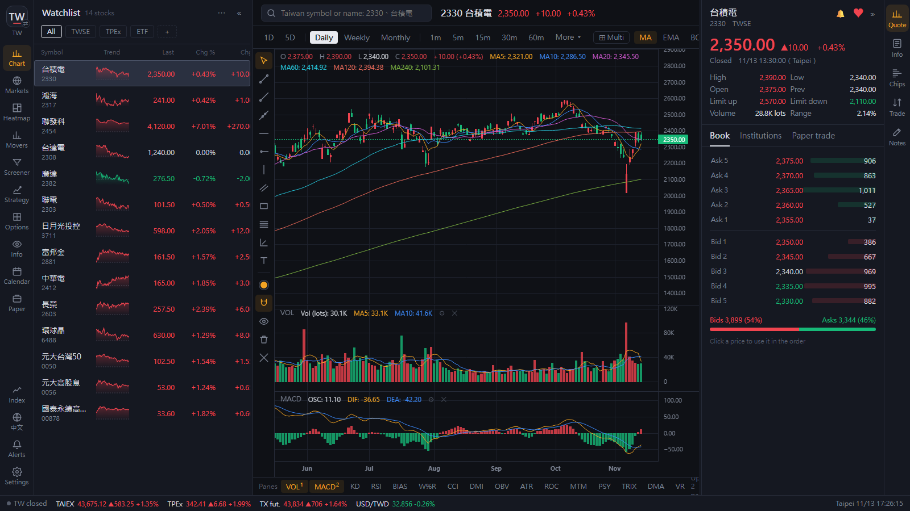
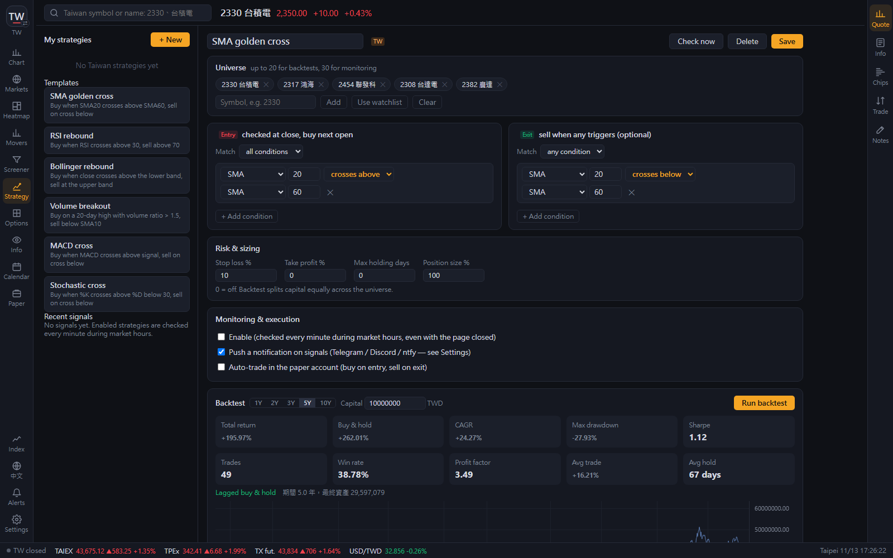
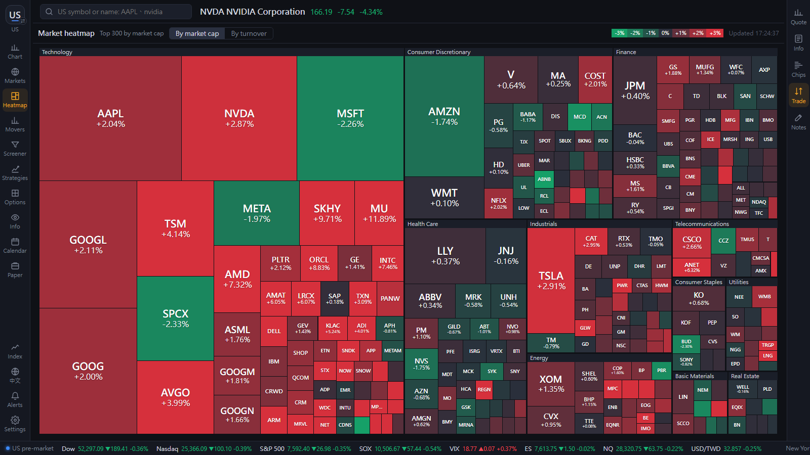
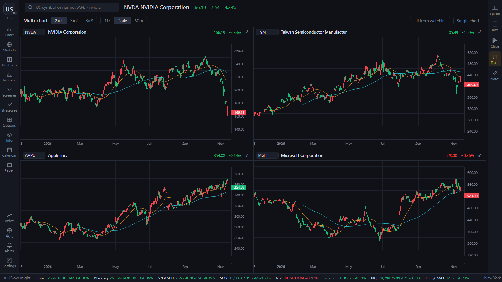
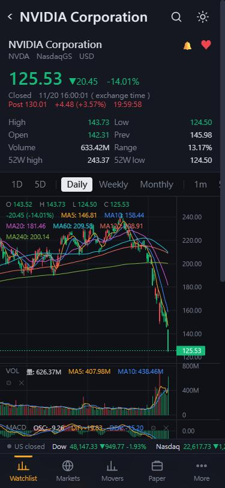

# NightMarket 🏮

*Taiwan trades by day, Wall Street by night — so Taiwanese investors watch US stocks at night, like strolling a night market (夜市).*

**A full-featured stock terminal for Taiwan 🇹🇼 and US 🇺🇸 markets — pure Python, zero dependencies.**

No `pip install`, no API keys, no account. Run one command and get real-time Taiwan quotes, US pre/post-market prices, 20+ indicators, drawing tools, a strategy backtester with push alerts, a market heatmap, and a paper-trading account.

[繁體中文說明](README.zh-TW.md) · MIT License · Python 3.10+

```bash
python server.py        # then open http://localhost:8765
```



## Why

- **Zero dependencies** — standard-library Python backend, plain HTML/JS frontend. Works on Windows, macOS, Linux, a Raspberry Pi, and even an Android phone (Termux).
- **Real-time Taiwan market data for free** — TWSE MIS quotes and 5-level order book (~5 s updates), real-time intraday bars, TAIEX futures and options.
- **US stocks with extended hours** — pre-market (04:00–09:30 ET) and after-hours (16:00–20:00 ET) prices and charts.
- **Test ideas before risking money** — build a strategy from indicator conditions, backtest it on years of history, then let it alert you (or auto-trade the paper account) when conditions are met.

## Features

| | |
|---|---|
| **Charts** | 1D/5D intraday, 1m–4h, daily/weekly/monthly/quarterly/yearly · 6 overlays (MA, EMA, Bollinger, SAR, Envelope, Donchian) · 16 indicator panes (Volume, MACD, KD, RSI, BIAS, W%R, CCI, DMI, OBV, ATR, ROC, MTM, PSY, TRIX, DMA, VR) with adjustable parameters |
| **Drawing tools** | Trend line, ray, extended line, horizontal/vertical lines, parallel channel, rectangle, Fibonacci, measure, text — draggable, magnet snap, saved per symbol |
| **Strategies & backtesting** | Visual condition builder (crosses above/below, >, <, …) over price, volume and indicators · 6 templates · equity curve vs. buy & hold, CAGR, max drawdown, Sharpe, win rate, profit factor, trade log · fees and taxes included, next-open fills (no look-ahead) |
| **Alerts & push** | Strategies are checked every minute during market hours (even with the page closed) · push to **Telegram**, **Discord** or **ntfy** · optional auto-trading in the paper account · simple price alerts too |
| **Screener** | Fundamental filters (price, change, volume, market cap, P/E, yield, P/B, sector) + technical conditions · turn results into a strategy in one click |
| **Heatmap** | Top 250 Taiwan / top 300 US stocks by market cap, grouped by sector |
| **Multi-chart** | 2×2, 3×2 or 3×3 grid |
| **Market data** | Global indices, futures, sector ETFs, FX, commodities, crypto · gainers/losers/volume movers · company profile, monthly revenue (TW), EPS, dividends, analyst targets (US), news, filings |
| **Options** | TAIEX options chain (incl. weeklies) and US options chain, paper trading |
| **Calendar** | Weekly view of earnings (pre/post-market), economic releases, dividends and market holidays |
| **Cost distribution** | Estimated holder cost distribution with profit ratio and concentration |
| **Paper trading** | Taiwan (lots/odd lots, fees, transaction tax), US (extended-hours limit orders), options · background matching of limit orders |
| **Everything else** | Taiwan/US mode switch, watchlist groups, notes, context menus, resizable panels, mobile layout, installable PWA, English / 繁體中文 UI |

| Strategy backtest | Market heatmap |
|---|---|
|  |  |

| Multi-chart | Mobile |
|---|---|
|  |  |

## Quick start

Requires Python 3.10+. Nothing to install.

```bash
git clone <this repo>
cd <repo folder>
python server.py
```

Open <http://localhost:8765>. On Windows you can also double-click `start.bat` for a standalone app window.

## Run it anywhere

| Where | How |
|---|---|
| Your computer | `python server.py` |
| Phone, anywhere (private) | Run it at home and use [Tailscale](https://tailscale.com): `tailscale serve --bg 8765`, then open `https://<machine>.<tailnet>.ts.net` on your phone (HTTPS, only your devices) |
| Phone on the same Wi-Fi | `python server.py --host 0.0.0.0 --password <secret>` |
| **Android phone, no computer** | Install Termux → `pkg install git python` → clone → `bash deploy/run-android.sh` → open `http://localhost:8765` in Chrome |
| Raspberry Pi / NAS | `deploy/nightmarket.service` (systemd) + Tailscale |
| Docker | `docker build -t nightmarket . && docker run -d -p 8765:8765 -e TWSTOCK_PASSWORD=<secret> -v nightmarket-data:/data nightmarket` |
| Windows .exe | `py -m pip install pyinstaller` then `build_exe.bat` |

Open it on a phone and use **Add to Home Screen** to get an app icon (PWA). Add `?lang=en` or `?lang=zh` to the URL to force a language, and `#view=heatmap` (or `strategy`, `screener`, `multi`, `calendar`…) to open a page directly.

## Strategy format

Strategies are plain JSON, so they are easy to share:

```json
{
  "name": "SMA golden cross",
  "mkt": "tw",
  "universe": ["2330", "2454"],
  "entry": { "mode": "all", "rules": [{ "a": {"k": "ma", "n": 20}, "op": "cross_up", "b": {"k": "ma", "n": 60} }] },
  "exit":  { "mode": "any", "rules": [{ "a": {"k": "ma", "n": 20}, "op": "cross_down", "b": {"k": "ma", "n": 60} }] },
  "stop_loss": 10, "take_profit": 0, "size_pct": 100
}
```

The engine lives in [`strategy.py`](strategy.py) (standard library only) and can be used on its own.

## Data sources

| Data | Source | Latency (measured) |
|---|---|---|
| Taiwan quotes & order book | TWSE MIS | ~5 s |
| Taiwan intraday bars | Yahoo Taiwan | real time |
| Taiwan fallback quotes | Yahoo Finance | ~20 min delay (only if MIS is unreachable; the UI says so) |
| TAIEX futures & options | TAIFEX MIS | real time |
| US quotes, charts, extended hours | Yahoo Finance | < 1 s during market hours |
| US options | Yahoo Finance | may be delayed |
| Company data, revenue, dividends, institutional flows | TWSE / TPEx open data, Yahoo Finance | daily |
| Earnings & economic calendar, US screener | Nasdaq | daily / live |
| News | Yahoo, cnyes | — |

All market data belongs to its providers. This app fetches data on your own machine for personal use; it does not store or redistribute it. **Please don't host it as a public service**, keep request rates modest (TWSE MIS temporarily blocks IPs that poll too fast), and respect each provider's terms. Tested from a data-center IP: TWSE, TPEx and Yahoo work; Nasdaq timed out.

## Project layout

```
server.py            backend: data fetching, paper trading, strategy monitor, push
strategy.py          indicators, condition engine, backtester
web/                 frontend (index.html, app.js, pages.js, features.js, panels.js, …)
deploy/              Android (Termux) script, systemd unit
Dockerfile, build_exe.bat, launcher.pyw, start.bat
```

Charts use [TradingView Lightweight Charts](https://github.com/tradingview/lightweight-charts) (Apache-2.0).

## Disclaimer

For education and research only. Data may be inaccurate, incomplete or delayed. Nothing here is investment advice, and backtest results do not predict future returns.

## License

[MIT](LICENSE) — covers this project's code only, not the market data it retrieves.
