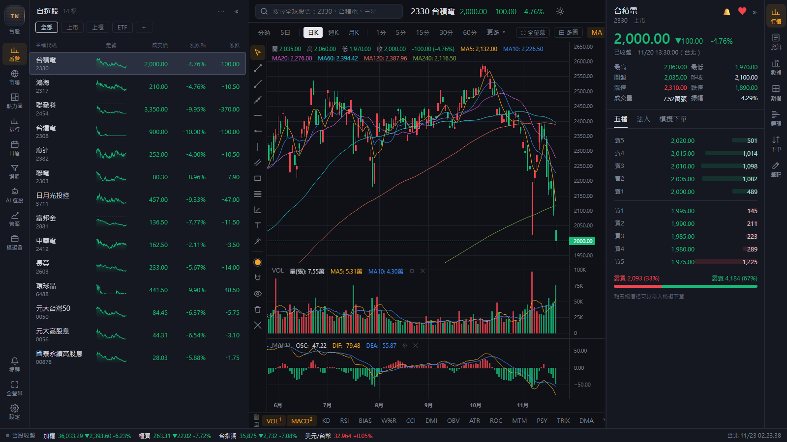
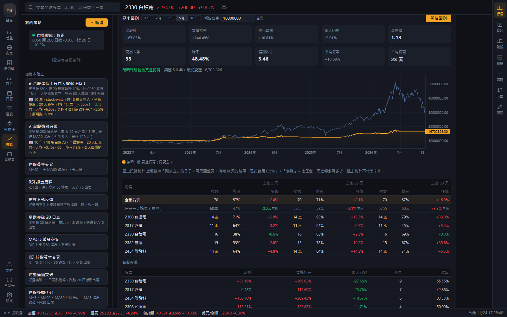
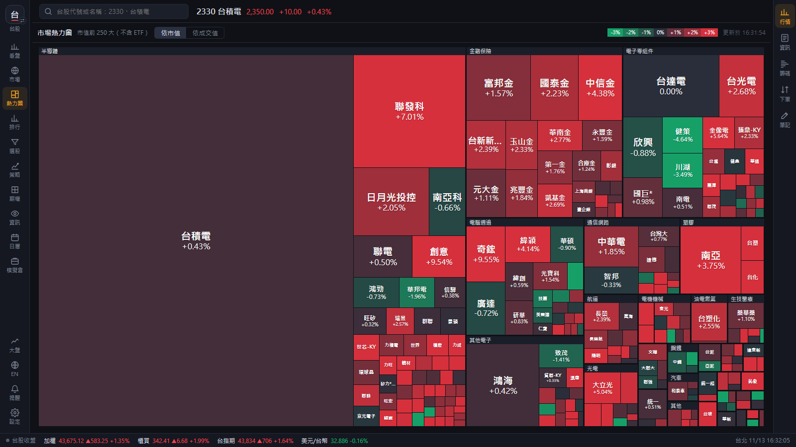
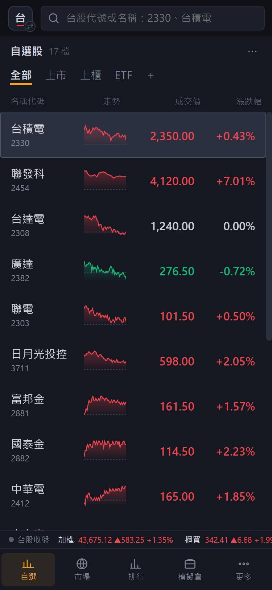

# NightMarket 夜市 🏮

[](https://github.com/mintguesss/NightMarket/actions/workflows/ci.yml) [](https://github.com/mintguesss/NightMarket/releases)   [](LICENSE)

*白天看台股，晚上逛美股——台灣人看美股就像逛夜市。*

**純 Python、零依賴的台股／美股看盤軟體。** 不用 `pip install`、不用 API 金鑰、不用註冊，一行指令就有台股即時報價與五檔、美股盤前盤後、20 多種指標、畫線工具、策略回測與推播提醒、市場熱力圖和模擬倉。

[English](README.md) · MIT 授權 · Python 3.10+

```bash
python server.py        # 打開 http://localhost:8765
```

> 這是個人學習用的專案，**不提供真實下單**，也不是投資建議。



| 策略回測 | 市場熱力圖 | 手機版 |
|---|---|---|
|  |  |  |

## 功能

**台股、美股兩個模式**：左上角切換，自選清單、分組、搜尋、排行、期權、新聞、日曆、模擬倉帳戶都各自獨立。

- **看盤**：分時、5日、日／週／月／季／年 K、1～240 分 K；美股可顯示盤前（04:00–09:30）與盤後（16:00–20:00）
- **技術指標**：主圖 MA、EMA、BOLL、SAR、包絡線、唐奇安；副圖 VOL、MACD、KD、RSI、BIAS、W%R、CCI、DMI、OBV、ATR、ROC、MTM、PSY、TRIX、DMA、VR（參數可調、最多兩個副圖）
- **畫線**：趨勢線、射線、延長線、水平線、水平射線、垂直線、平行通道、矩形、黃金分割、測量、文字（可拖曳、磁吸，每檔分開儲存）
- **自選股**：分組、排序、置頂、特別關注、備註、個股筆記、匯出 CSV、右鍵（手機長按）選單；刪除前會確認
- **報價**：台股五檔、三大法人（上市）、新聞
- **市場**：台股大盤／期貨／亞股／匯率；美股指數／期貨／類股 ETF／債券／商品／加密貨幣
- **排行**：漲幅、跌幅、成交量、成交值
- **期權**：台指選擇權（含週選）、美股選擇權 T 字報價，可模擬買進／平倉
- **資訊**：公司資料、關鍵數據（本益比、殖利率等）、台股月營收與重大訊息、每季 EPS、年度營收淨利、股利歷史、美股分析師目標價、個股新聞與市場快訊
- **日曆**：週檢視（本週焦點／業績／財經／權息／休市），左側月曆與國家篩選；台股除權息、休市日；美股財報（盤前／盤後）、配息、休市日；各國經濟數據（台北時間）
- **模擬倉**：起始資金台股 1,000 萬台幣、美股 3 萬美元（可在模擬倉頁重設）；台股（含手續費、證交稅、零股）、美股（含盤前盤後限價單）、期權；限價單背景自動撮合
- **價格提醒**：漲到／跌到／漲跌幅，跳出通知並發出提示音
- **策略與回測**：用指標條件組合進場／出場規則（向上穿越、大於…），6 種範本；回測顯示權益曲線、買進持有比較、年化報酬、最大回撤、夏普值、勝率、獲利因子與交易紀錄（隔日開盤成交、含手續費與稅）
- **條件提醒與自動模擬下單**：啟用的策略在交易時段每分鐘檢查（網頁關掉也會繼續），觸發時推播到 **Telegram／Discord／ntfy**，也可以自動在模擬倉下單
- **選股器**：價格、漲跌幅、成交量、市值、本益比、殖利率、淨值比、產業，加上技術條件；結果可一鍵轉成策略
- **市場熱力圖**：台股市值前 250、美股市值前 300，依產業分區
- **多圖同框**：2×2／3×2／3×3
- **介面語言**：繁體中文／English，可用網址 `?lang=en` 指定；`#view=heatmap` 等可直接開到指定頁面
- **右側面板**：最右邊的圖示選單切換行情、資訊（新聞／公告／營收／評級）、籌碼分布、模擬下單、筆記
- **籌碼分布**：依日 K 與換手率估算成本分布，顯示獲利比例、平均成本、90%／70% 成本集中度（估算值，非真實持股資料）
- **版面**：左右欄可拖曳調整寬度、收合；手機版為單欄操作（底部分頁列）

## 安裝與啟動

需要 Python 3.10 以上（Windows 建議從 [python.org](https://www.python.org/) 安裝，會附 `py` 指令）。不需要安裝任何套件。

**Windows 獨立視窗版**：雙擊 `start.bat`，會用 Edge 開一個沒有網址列的視窗，關掉視窗就結束。

**任何系統（瀏覽器版）**：

```bash
python server.py
```

然後打開 <http://localhost:8765>。

## 部署方式

| 方式 | 需要電腦一直開著？ | 怎麼做 |
|---|---|---|
| 本機使用 | 是 | `start.bat` 或 `python server.py` |
| 手機透過 Tailscale 連回家 | 是（或用樹莓派） | 電腦執行 `python server.py`，再執行 `tailscale serve --bg 8765`，手機開 `https://<電腦名稱>.<tailnet>.ts.net`。只有你的 Tailscale 裝置連得到，而且是 HTTPS，可以加入主畫面 |
| 同一個 Wi-Fi 的手機 | 是 | `python server.py --host 0.0.0.0 --password 你的密碼`，手機開畫面上顯示的網址 |
| **Android 手機單獨執行** | **否** | 安裝 Termux，`pkg install git python`、clone 這個 repo，執行 `bash deploy/run-android.sh`，用手機 Chrome 開 `http://localhost:8765` |
| 樹莓派／NAS 常駐 | 否（小主機一直開） | 參考 `deploy/nightmarket.service`（systemd 開機自動執行），搭配 Tailscale |
| Docker | 依主機而定 | `docker build -t nightmarket .`，`docker run -d -p 8765:8765 -e TWSTOCK_PASSWORD=密碼 -v nightmarket-data:/data nightmarket` |
| Windows 執行檔 | 是 | 到 [Releases](../../releases) 下載 `NightMarket.exe`（GitHub Actions 自動打包），或自己執行 `py -m pip install pyinstaller` 後跑 `build_exe.bat` |

**加入主畫面（PWA）**：用 `localhost` 或 HTTPS（例如 Tailscale serve）開啟時，手機瀏覽器選單的「加入主畫面」會變成一個 App 圖示，全螢幕開啟。iPhone 用 Safari 的「分享 → 加入主畫面」。

**密碼**：`--password`（或環境變數 `TWSTOCK_PASSWORD`）設定後，除了本機直接連線，其他連線都要輸入密碼（帳號隨意）。

**雲端主機**：實測從資料中心連線時，證交所、櫃買中心、Yahoo 都能正常取得資料，但 Nasdaq（美股財報與經濟日曆）會逾時。請只給自己使用、一定要設密碼，不要公開。

## 資料來源與即時性

| 資料 | 來源 | 即時性（實測） |
|---|---|---|
| 台股報價、五檔 | 證交所 MIS | 約 5 秒更新一次 |
| 台股當日分 K | Yahoo 奇摩股市 | 即時 |
| 台股歷史 K 線 | Yahoo Finance | 當日部分約延遲 20 分鐘（已用即時資料補上） |
| 台股備援報價 | Yahoo Finance | 約延遲 20 分鐘，只在 MIS 連不上時使用，畫面會提示 |
| 台股排行 | Yahoo 奇摩股市 | — |
| 三大法人、除權息、休市日、股票清單 | 證交所、櫃買中心 OpenAPI | 每日 |
| 台指期、台指選擇權 | 期交所 MIS | 盤中即時 |
| 美股報價、K 線、盤前盤後 | Yahoo Finance | 盤中延遲不到 1 秒 |
| 美股選擇權 | Yahoo Finance | 可能延遲 15 分鐘 |
| 新聞 | Yahoo 股市、鉅亨網 | — |
| 台股公司資料、月營收、重大訊息、本益比 | 證交所、櫃買中心 OpenAPI | 每日 |
| EPS、年度財務、股利、美股公司資料與分析師 | Yahoo Finance | 每日 |
| 美股財報、經濟數據 | Nasdaq | 每日 |

所有資料的權利屬於各資料提供者。本專案只在使用者自己的電腦上即時取得資料，不儲存、不轉發。請遵守各網站的使用條款，**不要把它架成公開服務**，也不要調高請求頻率（證交所 MIS 請求太密會暫時封鎖 IP）。

## 限制

- 不支援真實下單
- 沒有券商分點資料（官方來源需要驗證碼）
- 美股沒有五檔（需付費 Level 2 行情）、沒有夜盤（20:00–04:00）報價
- 三大法人目前只支援上市股票
- 期權模擬只能買進建倉、賣出平倉，不做賣方，到期不會自動結算
- 自選、畫線、設定存在瀏覽器的 localStorage；模擬倉存在 `paper.json`

## 專案結構

```
server.py         後端：抓資料、模擬倉撮合、策略監控、推播（只用 Python 標準函式庫）
strategy.py       技術指標、條件引擎、回測
launcher.pyw      Windows 獨立視窗啟動器
start.bat         雙擊啟動
web/
  index.html      頁面
  style.css       樣式（含手機版）
  app.js          核心：看盤、自選、報價、下單、版面
  pages.js        市場、排行、期權、資訊、日曆、模擬倉
  indicators.js   技術指標
  draw.js         畫線工具
  features.js     策略、回測、選股、熱力圖、多圖、推播設定
  i18n.js         英文介面
  panels.js       右側面板：資訊、籌碼分布、筆記
  mobile.js       手機版操作
  manifest.webmanifest, sw.js, icons/   加入主畫面（PWA）
deploy/           Android（Termux）啟動腳本、樹莓派 systemd 設定
tools/gen_icons.py  產生圖示（純 Python）
Dockerfile        容器版
build_exe.bat     打包 Windows 執行檔
```

圖表使用 [TradingView Lightweight Charts](https://github.com/tradingview/lightweight-charts)（Apache 2.0，從 unpkg CDN 載入）。

## 授權

程式碼以 [MIT 授權](LICENSE) 釋出。授權只涵蓋本專案的程式碼，不包含透過程式取得的市場資料；資料的權利仍屬於各資料提供者。

## 免責聲明

本專案僅供學習與研究，所有資訊不保證正確、完整或即時，不構成任何投資建議。使用者應自行承擔使用風險。
